# Diagramas · 2ª Etapa

Fuentes en Mermaid (`.mmd`). GitHub los dibuja en esta página; para editarlos, abrir el `.mmd` en [mermaid.live](https://mermaid.live) o en draw.io (Organizar → Insertar → Avanzado → Mermaid). Las imágenes están en `img/` y el anexo completo en `Diagramas-PP4-Etapa2.pdf`.

## 01. Entidad-relación

Fuente: [`01-entidad-relacion.mmd`](01-entidad-relacion.mmd)

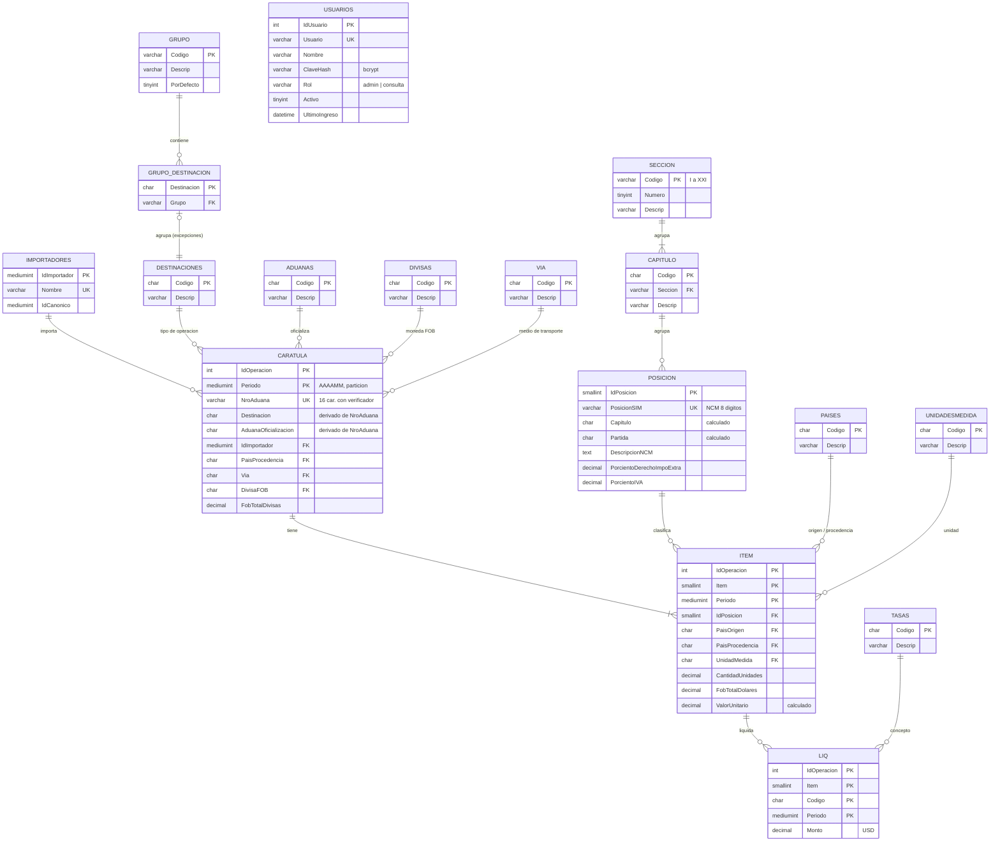

## 02. Casos de uso

Fuente: [`02-casos-de-uso.mmd`](02-casos-de-uso.mmd)

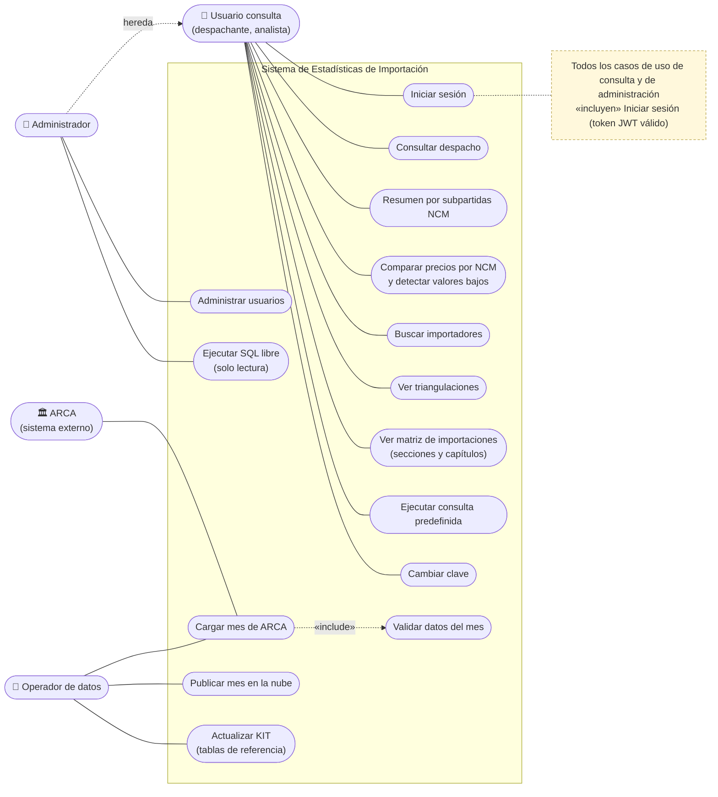

## 03. Secuencia: inicio de sesión

Fuente: [`03-secuencia-login.mmd`](03-secuencia-login.mmd)

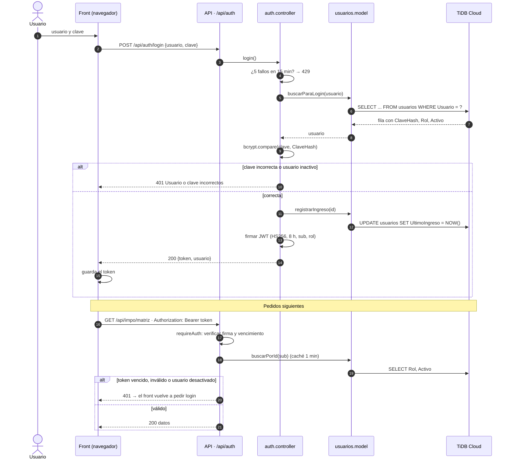

## 04. Secuencia: carga mensual

Fuente: [`04-secuencia-carga-mensual.mmd`](04-secuencia-carga-mensual.mmd)

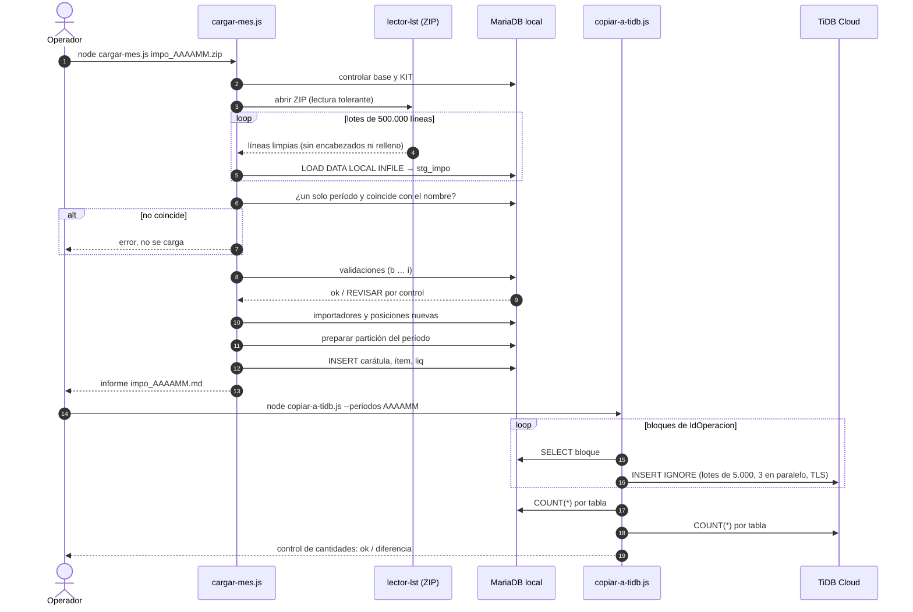

## 05. Actividades: proceso de carga

Fuente: [`05-actividades-carga.mmd`](05-actividades-carga.mmd)

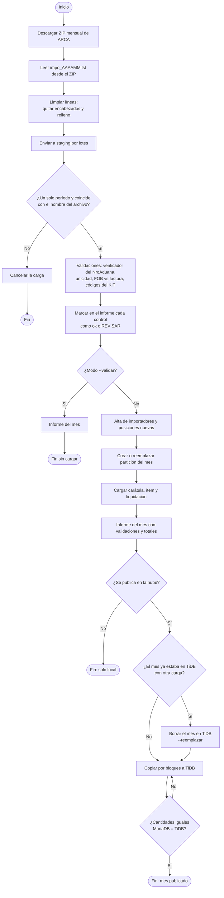

## 06. Estados: usuario

Fuente: [`06-estados-usuario.mmd`](06-estados-usuario.mmd)

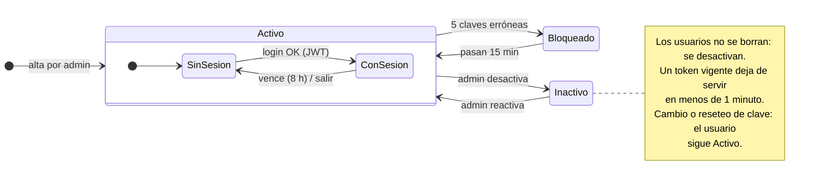

## 07. Estados: período

Fuente: [`07-estados-periodo.mmd`](07-estados-periodo.mmd)

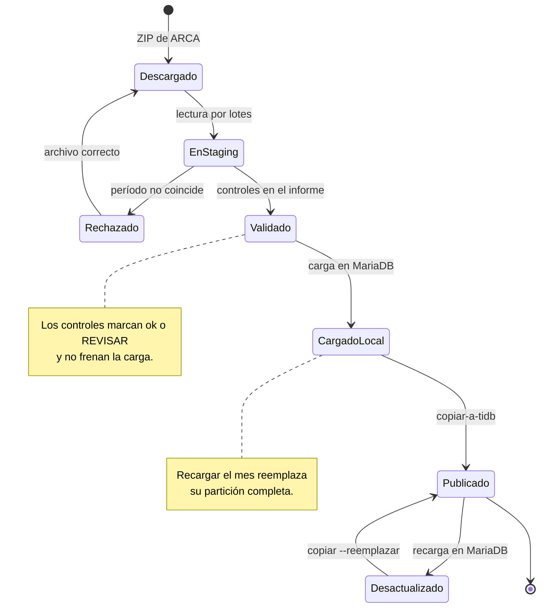

## 08. Componentes

Fuente: [`08-componentes.mmd`](08-componentes.mmd)

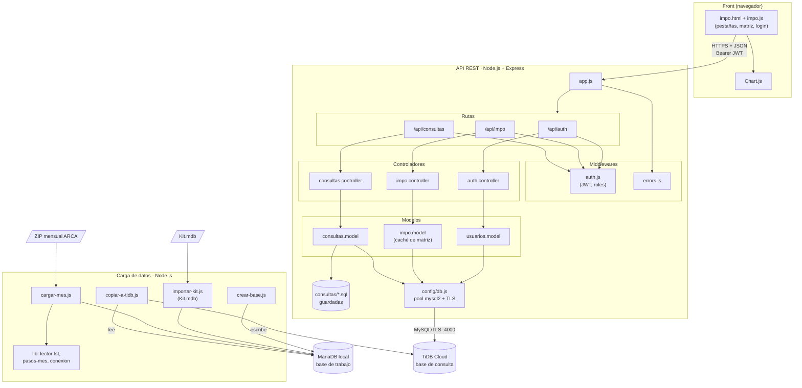

## 09. Despliegue

Fuente: [`09-despliegue.mmd`](09-despliegue.mmd)

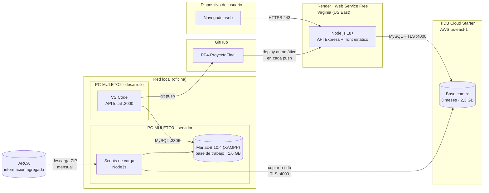

## 10. Clases: dominio

Fuente: [`10-clases-dominio.mmd`](10-clases-dominio.mmd)

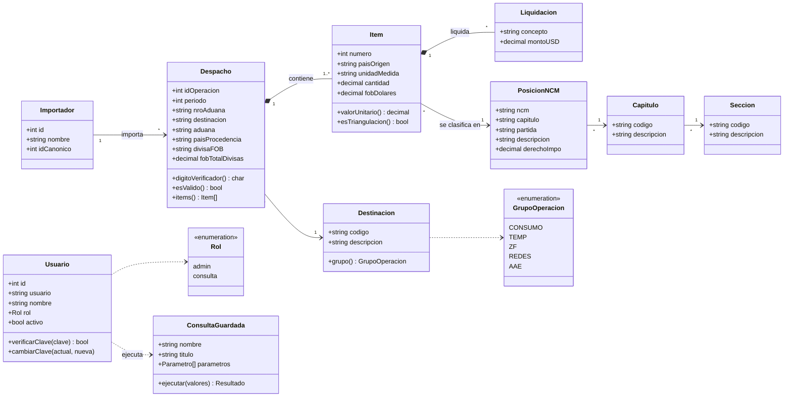

## 11. Clases: API

Fuente: [`11-clases-api.mmd`](11-clases-api.mmd)

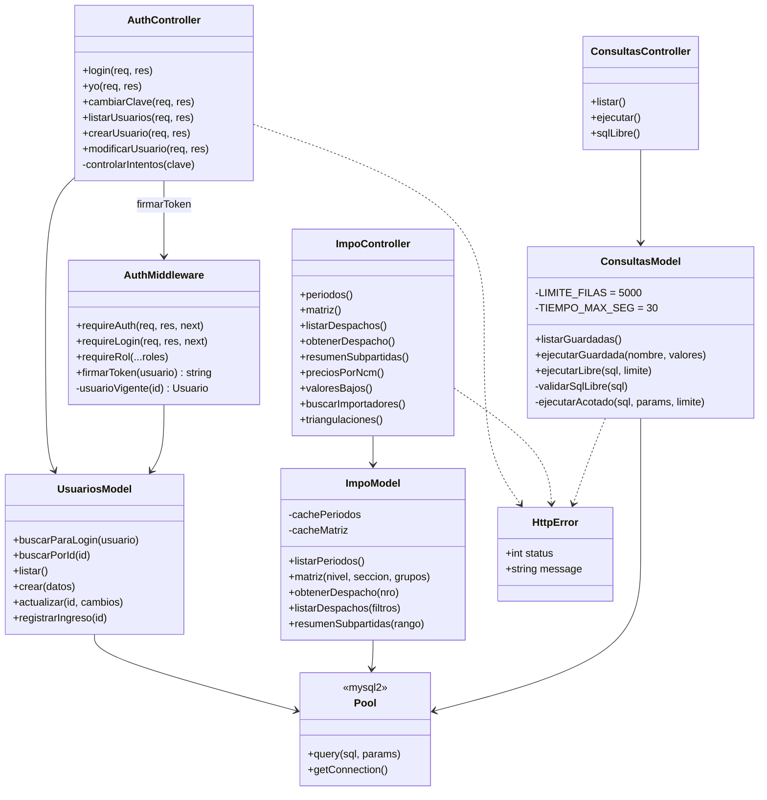
